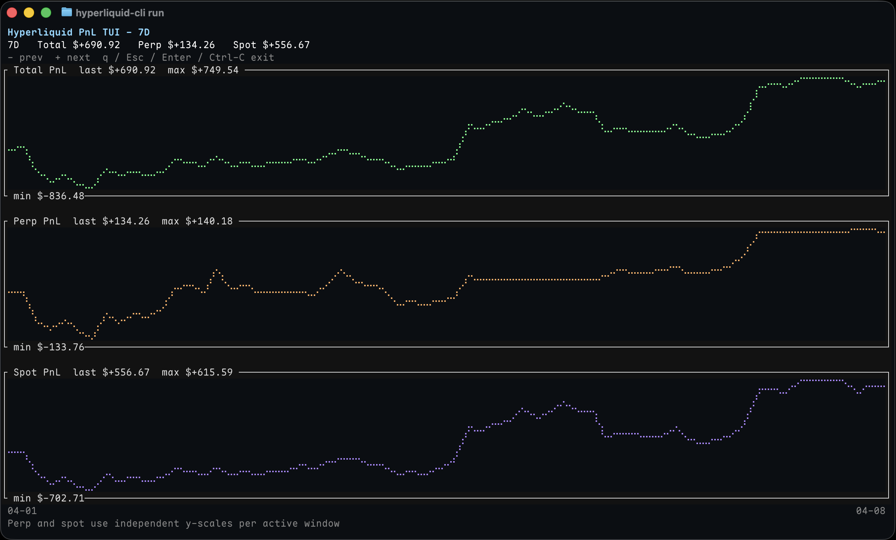

# Hyperliquid CLI

[](https://github.com/zydtiger/hyperliquid-cli)
[](https://python.org)
[](LICENSE)
[](https://github.com/zydtiger/hyperliquid-cli/actions)
[](https://github.com/zydtiger/hyperliquid-cli/actions/workflows/ci.yml)

A stateless, agent-friendly Hyperliquid trading and portfolio CLI with an optional interactive REPL and fullscreen TUIs. Connects directly to Hyperliquid in-process with lazy REST, WebSocket, and signing initialization—no background daemon required.



## Quick Start

### Installation

Requires Python 3.11 or newer.

```bash
# Clone the repository
git clone https://github.com/zydtiger/hyperliquid-cli.git
cd hyperliquid-cli

# Create virtual environment and install in development mode
uv venv
uv pip install -e .

# Activate the virtual environment
source .venv/bin/activate
```

### Setup Configuration

```bash
# Create a default configuration file at ~/.hyperliquid-cli/config.yaml
hyperliquid-cli create-config

# Overwrite an existing configuration file non-interactively
hyperliquid-cli create-config --force
```

Read-only public commands (`coins`, `info`, `watch`, `status`) work without a config file, and account read-only commands work with `--address 0x...` alone (no private key required).

## Usage

### Global Options

Global options can be placed either before or after the subcommand name:

- `-c, --config PATH`: Custom configuration file path (defaults to `~/.hyperliquid-cli/config.yaml`)
- `--address 0x...`: Override the Hyperliquid account address
- `--network mainnet|testnet`: Override the Hyperliquid network
- `--json`: Emit exactly one compact JSON object to stdout (silencing logs and progress output)

### Stateless Subcommands

**Portfolio & Account (read-only):**

```bash
hyperliquid-cli portfolio [--no-open-orders] [--no-today] [--json]
hyperliquid-cli balances [--json]
hyperliquid-cli positions [COIN] [--json]
hyperliquid-cli staking [--json]
hyperliquid-cli open-orders [--coin COIN] [--json]
hyperliquid-cli order-status <ORDER_ID> [--json]
hyperliquid-cli order-history [--limit N] [--since ISO_OR_MS] [--json]
hyperliquid-cli pnl [--window 1d|3d|7d|1m|3m|6m|1y|all] [--json]
hyperliquid-cli status [--json]
```

**Public Market Data (no config or address required):**

```bash
hyperliquid-cli coins [--type all|perp|spot] [--json]
hyperliquid-cli info <COIN> [--json]
hyperliquid-cli watch <COIN> [--interval 1m|5m|15m|1h|4h|1d] [--depth N] [--json]
```

**Trading & Position Mutations (all support `--dry-run` without signing):**

```bash
hyperliquid-cli order <buy|sell> <COIN> <QTY> [--price PRICE] [--tif GTC|IOC|ALO] \
    [--reduce-only] [--trigger-type stop|take --trigger-price PRICE] \
    [--tp PRICE] [--sl PRICE] [--dry-run] [--json]
hyperliquid-cli cancel-order [ORDER_ID] [--all] [--coin COIN] [--dry-run] [--json]
hyperliquid-cli modify-order <ORDER_ID> [--price PRICE] [--quantity QTY] [--dry-run] [--json]
hyperliquid-cli change-leverage <COIN> <LEVERAGE> [--cross|--isolated] [--dry-run] [--json]
hyperliquid-cli update-margin <COIN> --amount <SIGNED_USD> [--dry-run] [--json]
```

### JSON Contract & Exit Codes

In `--json` mode, every command prints one compact JSON line (`sort_keys=True`) to stdout:

- **Exit codes**: `0` = success, `1` = runtime / exchange / config error, `2` = CLI argument / validation error.
- **Standard success envelope** (all non-`portfolio` commands):
  `{"as_of":"...","command":"<cmd>","data":...,"ok":true,"source":{"account_address":"...","network":"mainnet"}}`
- **Error envelope** (all commands including `portfolio`):
  `{"as_of":"...","command":"<cmd>","error":{"message":"...","type":"<ExcClass>"},"ok":false,"source":{"account_address":"...","network":"mainnet"}}`
- **`portfolio --json`**: emits the unified portfolio snapshot directly with top-level `ok`, `as_of`, `source`, `account`, `allocation`, `portfolio`, `perp_positions`, `spot_balances`, `staking`, `vaults`, `open_orders`, `closed_today`, and `errors`.

### Interactive REPL

Launch the interactive session with no subcommand or via `repl`:

```bash
hyperliquid-cli
hyperliquid-cli repl --network testnet
```

Available REPL commands:

```text
hyperliquid> order              # Launch order creation wizard or quick order
hyperliquid> positions          # Show open positions
hyperliquid> balances           # Display account balances
hyperliquid> staking            # Show HYPE staking delegations
hyperliquid> pnl                # Launch fullscreen multi-window PnL TUI
hyperliquid> watch BTC          # Launch live WebSocket watch TUI (closes WS on exit)
hyperliquid> open_orders        # List all open orders
hyperliquid> order_history 10   # Show recent filled orders
hyperliquid> cancel_order all   # Cancel one or all open orders
hyperliquid> order_status 12345 # Get specific order details
hyperliquid> modify_order 12345 # Modify existing limit order
hyperliquid> change_leverage ETH 10
hyperliquid> update_margin ETH -0.5
hyperliquid> info BTC           # Ticker and market metadata
hyperliquid> status             # Show exchange connectivity and account status
hyperliquid> help               # Show available commands
hyperliquid> quit               # Exit the CLI
```

## Configuration

The default configuration file is `~/.hyperliquid-cli/config.yaml` (see `config.example.yaml`):

```yaml
hyperliquid:
  account_address: "your_ethereum_address_here"
  private_key: "your_hyperliquid_private_key_here"
  network: "mainnet" # 'mainnet' or 'testnet'

trading:
  default_slippage: 0.005 # 0.5%
  default_time_in_force: "GTC"

agent:
  api_key: "your_openai_api_key_here"
  openai_base_url: "your_openai_compatible_base_url_here"
  model_id: "your_model_id_here"
```

## Development Setup

```bash
# Set up development environment
uv sync --dev
uv tool install prek
prek install

# Run tests
uv run pytest -v .

# Format and lint
uv run ruff format .
uv run ruff check .

# Type checking
uv run mypy src tests
```

## Project Structure

```text
hyperliquid-cli/
├── src/
│   ├── cli/             # Stateless Typer commands, JSON runtime, formatters, REPL & TUIs
│   ├── exchange/        # Lazy in-process Hyperliquid REST/WS/signing client
│   └── models/          # Centralized Pydantic models and configuration
├── tests/               # Unit tests for config, exchange, and CLI
└── config.example.yaml  # Configuration template
```

## Security

- Read-only commands and `--dry-run` validations never load or require `private_key`.
- `status` reports `has_private_key` as a boolean only and never prints credentials.
- Supports `testnet` for safe end-to-end testing.

## License

GNU Affero General Public License v3.0 - see [LICENSE](LICENSE) for details.
